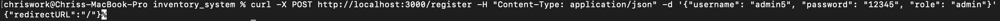

# Security Review: Inventory System Portal

This document records a security review of the inventory and operations app, which I built and ran for a 20+ person, two-location salon from 2021 to early 2025. The review covers what I found, how I confirmed each issue, and how each one is being fixed.

**Status:** In progress. Findings are being reproduced and fixed on the `security-fixes` branch.

| | |
|---|---|
| **Reviewer** | Christopher Cho |
| **Started** | October 2026 |
| **Code reviewed** | `main` at commit `2639461` |
| **Environment** | Local only (`localhost`), Node 16, MongoDB test database with fake data |
| **Methods** | Black-box testing with `curl` and browser developer tools, code review, `npm audit` |

All testing was done against a local copy with a test database. No production system or real customer or employee data was used.

---

## Summary

Severity reflects impact on the original deployment: a public web app where anyone could reach the API.

| ID | Finding | Severity | Status | Fix |
|---|---|---|---|---|
| SEC-01 | Anyone can register an admin account without logging in | Critical | Confirmed | Phase 1 |
| SEC-02 | One unauthenticated request crashes the server | High | Confirmed | Phases 3, 5 |
| SEC-03 | User input is not validated (invalid roles, weak passwords, optional location) | Medium | Confirmed | Phase 3 |
| SEC-04 | Login hangs for any role other than `admin` or `employee` | Low | Confirmed | Phase 3 |
| SEC-05 | Sessions can be forged by anyone who knows the cookie signing key | Medium | Confirmed (by design review) | Phases 4, 13 |
| SEC-06 | Login error messages reveal which usernames exist | Low | Found in code review | Phase 4 |
| SEC-07 | Employees can call admin API routes | Critical | To reproduce | Phase 1 |
| SEC-08 | Password hashes returned in API responses | High | To reproduce | Phase 2 |
| SEC-09 | Several API routes require no login | High | To reproduce | Phase 1 |
| SEC-10 | Employees can open the admin interface | Medium | To reproduce | Phase 1 |
| SEC-11 | Requests hang when a database call fails | Medium | To reproduce | Phase 5 |
| SEC-12 | Session cookie lacks `Secure` and `SameSite`, lasts 30 days | Medium | To reproduce | Phase 4 |
| SEC-13 | No rate limiting on login | Medium | To reproduce | Phase 4 |
| SEC-14 | Logout uses a GET request | Low | Found in code review | Phase 4 |
| SEC-15 | Password reset page calls a route that does not exist | Low | To reproduce | Phase 8 |
| SEC-16 | Outdated dependencies with known vulnerabilities | To be rated | To reproduce | Phase 7 |
| SEC-17 | bcrypt cost factor of 8 is below current recommendations | Low | Found in code review | Phase 4 |

---

## Route audit

Every API route, labeled with who should be able to use it. "Current check" is what the code enforces today.

> To be completed. Fill in one row per route from `routes/`.

| Method | Path | Should be | Current check | Gap? |
|---|---|---|---|---|
| POST | `/api/login` | Public | None | No |
| POST | `/register` | Admin only | None | **Yes** |
| GET | `/api/current_user` | Any logged-in user | None (returns `req.user`) | Check response fields |
| | | | | |

---

## Confirmed findings

### SEC-01: Anyone can register an admin account without logging in

**Severity:** Critical
**Location:** `routes/authRoutes.js`, `POST /register`

**What happens:** The registration route has no authentication or authorization check, and it saves whatever `role` the request sends. Anyone who knows the endpoint can create an admin account and then log in to the admin dashboard.

**Impact:** Full takeover of the application. An attacker gets every admin capability: managing staff accounts, inventory, locations, and all stored records.

**Reproduce:**
```bash
curl -X POST http://localhost:4000/register \
  -H "Content-Type: application/json" \
  -d '{"username":"attacker","password":"<password>","role":"admin","location":"<location id>"}'
```
Then log in as `attacker`. The login response redirects to the admin dashboard.

**Evidence:**




**Root cause:** Access to the registration form was restricted only in the frontend (it lives under the admin dashboard at `/app/register`). The API endpoint behind it was never protected.

**Fix:**
- Created requireAdmin middleware
- Added requireAdmin middleware to authRoutes.js

**Verification (planned):** Automated tests confirm that `/register` returns 401 with no session and 403 for an employee session.

---

### SEC-02: One unauthenticated request crashes the server

**Severity:** High
**Location:** `routes/authRoutes.js`, `POST /register`

**What happens:** Sending a registration request with no `role` makes the server process exit. The route sets `newUser.role = role` even when `role` is missing. Assigning `undefined` explicitly overrides the schema's `default: "employee"`, so Mongoose's `required` check fails on save. The route is `async` with no `try/catch`, and Express 4 does not catch errors from `async` handlers, so the error becomes an unhandled promise rejection. Since Node 15, an unhandled rejection ends the process by default.

**Impact:** Denial of service. Anyone can take the app offline with one request and repeat it whenever the host restarts it. No login is needed.

**Reproduce:**
```bash
curl -X POST http://localhost:4000/register \
  -H "Content-Type: application/json" \
  -d '{"username":"admin2","password":"<password>"}'
```
The client receives `curl: (52) Empty reply from server`. The server logs:
```
ValidationError: users validation failed: role: Path `role` is required.
[nodemon] app crashed - waiting for file changes before starting...
```

**Evidence:** _Add the full stack trace and curl output._

**Note on Node versions:** Production ran on Node 14, where an unhandled rejection only logs a warning, so there this request most likely hangs instead of crashing the server. Upgrading Node without fixing error handling first would have turned a hanging request into a crash. This is why error handling (Phase 5) is scheduled before dependency upgrades (Phase 7).

**Related, to verify:** The `password` field is not required in the schema. Registering with no password may also crash the server when bcrypt hashes `undefined`, and logging in as a user with no stored password may crash inside the Passport strategy.

**Fix (planned):**
- Validate the request before touching the database (Phase 3).
- Wrap every `async` route in `try/catch` and add a central error handler that returns a generic 500 (Phase 5).

**Verification (planned):** Tests send requests with each required field missing and expect a 400 response, with the server still running afterward.

---

### SEC-03: User input is not validated

**Severity:** Medium
**Location:** `routes/authRoutes.js`, `models/Users.js`

**What happens:**
- `role` accepts any string. A user was created with `"role":"superuser"`.
- Any password is accepted, including very short ones like `12345`.
- `location` is optional. A user can be created with no location, which also means requiring a location ID never stopped an attacker (see SEC-01).

**Impact:** Invalid data can be stored, which leads directly to SEC-02 and SEC-04. Weak passwords make guessing attacks easier, especially with no rate limiting (SEC-13).

**Reproduce:**
```bash
curl -X POST http://localhost:4000/register \
  -H "Content-Type: application/json" \
  -d '{"username":"baduser","password":"<password>","role":"superuser","location":"<location id>"}'
```

**Evidence:** _Add the curl output and the stored document from the database._

**Fix (planned):** Validate every write route with a validation library. Restrict `role` to `employee` and `admin` in both the route and the schema (`enum`). Require `location` and `password`, and set a minimum password length. Reject unknown fields and non-string values.

---

### SEC-04: Login hangs for any role other than `admin` or `employee`

**Severity:** Low
**Location:** `routes/authRoutes.js`, `POST /api/login`

**What happens:** After a successful password check, the login route sends a response only when the role is `admin` or `employee`. For any other role, such as the `superuser` account from SEC-03, no response is sent. The request hangs and no session cookie reaches the client.

**Impact:** Low on its own, and it happens to block the `superuser` account from getting a session. That protection is accidental. The real problem is that an invalid role could be stored at all (SEC-03), and that a code path can finish without sending a response (see SEC-11).

**Reproduce:**
```bash
curl -v --max-time 10 -X POST http://localhost:4000/api/login \
  -H "Content-Type: application/json" \
  -d '{"username":"baduser","password":"<password>"}'
```
The request times out after 10 seconds with no response.

**Fix (planned):** Fixed by restricting roles (SEC-03). Every code path in the login route will also send a response.

---

### SEC-05: Sessions can be forged by anyone who knows the cookie signing key

**Severity:** Medium
**Location:** `index.js` (`cookie-session` setup), `passport/setup.js`

**What happens:** The session is stored entirely in the cookie. Decoding the `session` cookie shows only the user ID:
```json
{"passport":{"user":"<user id>"}}
```
A second cookie, `session.sig`, is an HMAC signature made with `cookieKey`. Anyone who has the key can create a valid session for any user ID without a password.

**Impact:** If the production `cookieKey` was ever weak, reused, or leaked, every account could be impersonated. Because the API also does not check roles (SEC-07), a forged session for any user gives full access.

**Fix (planned):**
- Use a new, long, random `cookieKey` for any new deployment and never reuse the original.
- Check whether the original key appears in the old deployment's git history.
- Shorten session lifetime and add cookie flags (SEC-12).

---

### SEC-06: Login error messages reveal which usernames exist

**Severity:** Low
**Location:** `passport/setup.js`

**What happens:** Login returns "User does not exist" for an unknown username and "Incorrect password" for a known one. An attacker can use the difference to build a list of valid usernames, then focus guessing on those.

**Fix (planned):** Return the same message for both cases, such as "Incorrect username or password."

---

## Findings still to reproduce

Each of these will get the same write-up as the confirmed findings once it has been tested.

- **SEC-07:** Log in as an employee, then call `GET /api/employees` and `DELETE /api/employees/<id>`.
- **SEC-08:** Check `/api/employees` and `/api/current_user` responses for `password` fields.
- **SEC-09:** Call `/api/dashboard`, `/api/locations/add`, and `/api/callReceptionist` with no session.
- **SEC-10:** Log in as an employee in the browser and open `/app`.
- **SEC-11:** As an admin, request `/api/employees/notarealid` with a 10-second timeout.
- **SEC-12:** Inspect the session cookie's flags and expiry in browser developer tools.
- **SEC-13:** Send 20 failed logins in a row and confirm nothing slows or blocks them.
- **SEC-15:** Submit the password reset form and confirm the request fails.
- **SEC-16:** Run `npm audit` in the project root and in `client/`, and record the results.
- **Attack chain:** Register an admin with no location, log in, and read real location IDs from the API.
- **Other routes:** Check every other `async` route for the crash pattern in SEC-02.

---

## Fix plan

| Phase | Work | Findings addressed |
|---|---|---|
| 1 | Access control: `requireAdmin` middleware, locked-down `/register`, login checks on open routes, seed script, own-data checks, frontend role checks | SEC-01, 07, 09, 10 |
| 2 | Remove password hashes from every response | SEC-08 |
| 3 | Input validation on every write route | SEC-02, 03, 04 |
| 4 | Sessions and authentication: cookie flags, rate limiting, password policy, uniform login errors, POST logout, higher bcrypt cost | SEC-05, 06, 12, 13, 14, 17 |
| 5 | Error handling: `try/catch` everywhere and a central error handler | SEC-02, 11 |
| 6 | Security headers (Helmet) and HTTPS | General hardening |
| 7 | Upgrade Node and dependencies, clear `npm audit` | SEC-16 |
| 8 | Build password reset properly or remove it | SEC-15 |
| 10 | Automated security tests for every fix | All |
| 12 | Log failed logins and 403s, forward to Splunk, alert on brute force | SEC-13 |

---

## Lessons learned

- **The frontend is not a security boundary.** Hiding the registration form and admin pages in React did nothing to protect the API behind them.
- **Keeping code private is not protection.** This repository is public, so an attacker can read the schema and routes directly. Every control has to hold up when the attacker knows exactly how the app works.
- **Validation without error handling still fails.** The schema rejected bad data correctly, but the unhandled error took down the whole server.
- **Upgrades change behavior.** The same bug hangs on Node 14 and crashes on Node 16.

---

## Reporting a vulnerability

If you find a security issue in this project, please report it privately through GitHub's **Security → Report a vulnerability** form on this repository rather than opening a public issue.
